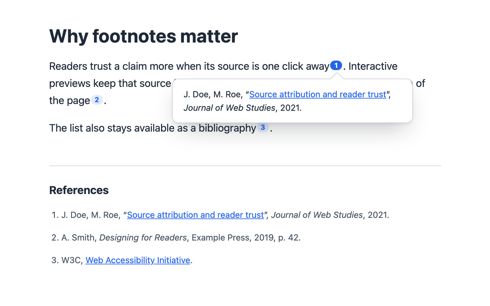

# Footnotes Plugin

The **Footnotes** plugin enhances the standard Markdown Extra footnotes generated by Grav. It provides accessible, interactive footnote previews through [littlefoot](https://github.com/goblindegook/littlefoot) and a `[references]` shortcode for placing the page's full reference list exactly where it belongs in the content.

All JavaScript and CSS assets are packaged with the plugin: no third-party CDN request is made.



## Features

- Uses Grav's native Markdown Extra footnote syntax.
- Turns footnote calls into keyboard-accessible interactive buttons.
- Shows a readable bottom-sheet interface on touch devices.
- Preserves a usable no-JavaScript and print fallback.
- Loads its assets only on pages that contain footnotes.
- Adds `[references]` to move a page's generated footnote list to a chosen location.
- Can keep the complete reference list visible at the end of the content, with an optional heading.
- Can describe the footnotes as schema.org citations in JSON-LD, with DOI detection.
- Settings can be overridden page by page in the front matter.

## Requirements

- Grav `>= 1.7.42`
- [Shortcode Core](https://github.com/getgrav/grav-plugin-shortcode-core) `>= 5.3.0` (installed automatically by GPM)
- Markdown Extra footnotes enabled in Grav:

  ```yaml
  pages:
    markdown:
      extra: true
  ```

## Installation

### GPM installation (recommended)

From the root directory of your Grav site:

```bash
bin/gpm install footnotes
```

GPM installs the plugin in `user/plugins/footnotes` and installs its Shortcode Core dependency when necessary.

### Manual installation

Download this repository, extract it into `user/plugins`, and ensure that the resulting directory is named `footnotes`:

```text
user/plugins/footnotes
```

Then install Shortcode Core if it is not already present:

```bash
bin/gpm install shortcode-core
```

## Usage

Write footnotes with the regular Markdown Extra syntax:

```markdown
As a serious study demonstrates[^study], the result matters.

[^study]: John Doe et al., [Example study](https://pubmed.ncbi.nlm.nih.gov/).
```

Grav renders the footnote call and its corresponding reference automatically. The plugin enhances the result in the browser without changing your source content.

### Choose a footnote identifier

The text between `[^` and `]` is an **identifier**. The identifier in the call and the definition must match exactly, but it does not have to be a number. Both of these forms are valid:

```markdown
A numbered note.[^1]

[^1]: The text of the first note.
```

```markdown
I can guarantee it works.[^source]

[^source]: Trust me bro.
```

For an editorial workflow, numeric identifiers (`1`, `2`, `3`, …) are often the clearest convention. Named identifiers are useful when they make the source easier to recognise while editing. In either case, use each identifier only once per page.

### Place the reference list with `[references]`

By default, Markdown Extra places the footnote list at the end of the page. Add the standalone `[references]` shortcode where you want the complete list to appear instead:

```markdown
As a serious study demonstrates[^study], the result matters.

[^study]: John Doe et al., [Example study](https://pubmed.ncbi.nlm.nih.gov/).

## References

[references]
```

The shortcode outputs the **complete list of footnotes used on that page**, preserving numbering, links, emphasis, and other Markdown formatting. It should appear once per page and be on its own line.

By default, the return arrows are hidden in a placed bibliography because Markdown Extra produces one arrow for every occurrence of a citation. Set `show_reference_backlinks: true` to retain them: each arrow is an anchor that takes the reader directly to the corresponding in-text citation.

If a page contains `[references]` but no footnotes, the shortcode renders nothing.

> `[references]` needs the Shortcode Core plugin. It is a required GPM dependency of this plugin.

### Show the reference list at the end of the content

Without `[references]`, littlefoot turns the Markdown Extra list into a print-only fallback. Set `references_auto: true` to keep the complete list visible as a bibliography at the end of `page.content` on every page that has no `[references]` shortcode. `references_title` adds an optional heading above it:

```yaml
references_auto: true
references_title: References
```

The list keeps the order, numbering, links and formatting generated by Markdown Extra. `[references]` always takes precedence over the automatic list.

### Publish references as JSON-LD

Set `jsonld: true` to add a schema.org graph to the document head. It lists every footnote of the page, whether the list is placed with `[references]`, shown automatically, or hidden:

```json
{
  "@context": "https://schema.org",
  "@type": "WebPage",
  "@id": "https://example.com/my-page#webpage",
  "url": "https://example.com/my-page",
  "citation": [
    {
      "@type": "CreativeWork",
      "text": "John Doe et al., Example study, 2020.",
      "url": "https://doi.org/10.1000/xyz123",
      "identifier": { "@type": "PropertyValue", "propertyID": "DOI", "value": "10.1000/xyz123" }
    }
  ]
}
```

- `text` keeps the formatted citation: footnotes have no reliable author, title or date fields.
- `url` is the first external `http(s)` link of the footnote.
- A DOI is detected from a `doi.org` link or a `doi:10.…` mention.
- Set `jsonld_id_suffix` to the suffix of your theme's own `WebPage` node (for example `#webpage`): search engines then merge both graphs into one page.

Enable it only when footnotes are bibliographic sources. Explanatory notes are not citations.

Themes that already output a schema.org graph can disable `jsonld` and merge the citations themselves with the `footnotes_citations()` Twig function:

```twig


```

### Per-page settings

Every setting can be overridden in a page's front matter:

```yaml
footnotes:
  references_auto: true
  references_title: Sources
  jsonld: false
```

`footnotes: false` disables the plugin on that page.

> Grav caches processed page content. Clear the cache after changing `references_auto` or `references_title` so that already rendered pages are updated.

### Insert a reference from Admin Next

In Grav Admin Next's default Markdown editor, use the footnote toolbar button (asterisk icon) to insert `[^1]` at the cursor. Its tooltip reminds you to replace `1` with the next unused number, then add the matching definition elsewhere in the page:

```markdown
[^1]: The source or note text.
```

The button deliberately inserts a number because it is the recommended editorial convention. You may still replace it with a descriptive identifier if that better fits the page, provided the call and definition use exactly the same identifier.

The button uses Grav's official `onApiMarkdownEditorButtons` extension point. It is not injected into the editor with custom DOM code.

## Configuration

Copy `user/plugins/footnotes/footnotes.yaml` to `user/config/plugins/footnotes.yaml` before changing values, or configure the plugin in the Grav Admin panel.

```yaml
enabled: true
hover: true
hover_delay: 250
dismiss_on_unhover: true
dismiss_delay: 250
allow_multiple: false
# Show one return link for each in-text use of a bibliography entry.
show_reference_backlinks: false
# Keep the generated list visible at the end of page.content.
references_auto: false
# Optional heading above the automatic list.
references_title: ''
# Emit schema.org citation JSON-LD for the page's footnotes.
jsonld: false
# Suffix appended to the page URL for the JSON-LD @id, e.g. '#webpage'.
jsonld_id_suffix: ''
# Load the plugin's visual stylesheet.
built_in_css: true
```

| Setting | Default | Description |
| --- | ---: | --- |
| `enabled` | `true` | Enables the plugin. |
| `hover` | `true` | Opens previews on hover when a fine pointer is available. Keyboard and touch interactions remain click-based. |
| `hover_delay` | `250` | Delay before opening a preview on hover, in milliseconds. |
| `dismiss_on_unhover` | `true` | Closes a hover-opened preview after leaving it. |
| `dismiss_delay` | `250` | Delay before closing after pointer leave, in milliseconds. |
| `allow_multiple` | `false` | Allows multiple footnote previews to stay open simultaneously. |
| `show_reference_backlinks` | `false` | Shows the Markdown-generated return links in a placed bibliography. A repeated source has one link for every in-text citation, and each link goes to that citation. |
| `references_auto` | `false` | Shows the complete footnote list as a bibliography at the end of `page.content` when the page has no `[references]` shortcode. |
| `references_title` | `''` | Heading (`h2`) above the automatic list. Empty means no heading. |
| `jsonld` | `false` | Adds a schema.org `WebPage` graph with one `citation` per footnote to the document head. Enable it only when footnotes are bibliographic sources. |
| `jsonld_id_suffix` | `''` | Appended to the page URL to build the JSON-LD `@id`, so it can match the theme's `WebPage` node. |
| `built_in_css` | `true` | Loads the plugin's visual stylesheet. Disable it to style footnotes from the theme; littlefoot's base stylesheet always loads. |

## Styling

The plugin stylesheet only sets CSS custom properties. Override them in your theme to match its colours:

```css
:root {
  --footnotes-accent: #006fbb;       /* buttons, links, focus ring */
  --footnotes-accent-soft: #d9f3ff;  /* button background, targeted item */
  --footnotes-accent-text: #fff;     /* text of an active button */
  --footnotes-surface: #fff;         /* popover background */
  --footnotes-text: #152741;         /* popover text, list heading */
  --footnotes-muted: #505c6b;        /* reference list text */
  --footnotes-border: #ced9e5;
  --footnotes-radius: .625rem;
  --footnotes-font-family: Georgia, serif; /* optional; the page font by default */
}
```

The plugin's defaults have zero specificity, so a theme rule always wins, whatever the stylesheet order. Set `built_in_css: false` to write all the styles yourself; littlefoot's base stylesheet still loads.

## Accessibility and fallback behaviour

Footnote controls remain usable with mouse, keyboard, and touch input. The original reference list remains available if JavaScript is unavailable, and is retained for printing. On small/touch screens, littlefoot displays notes in a panel that is easier to read than a floating tooltip.

## Credits

Interactive previews are provided by [littlefoot](https://github.com/goblindegook/littlefoot), distributed under the MIT License. Its unmodified 4.1.4 JavaScript and base stylesheet are included in `assets/`; see `assets/LICENSE-littlefoot.txt`.

## License

This plugin is released under the [MIT License](LICENSE).
